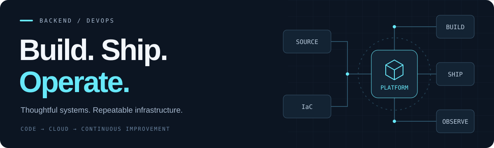

  

# Hi, I'm Dat 👋

### Backend & DevOps Engineer

**Phan Trinh Tien Dat** · Da Nang, Vietnam

I build backend services and automate their journey to the cloud.

  
  

[Tech stack](#tech-stack) &nbsp; / &nbsp; [Certification goals](#certification-goals) &nbsp; / &nbsp; [Learning next](#learning-next)

## A little about me

My focus sits where **backend engineering meets infrastructure**: Spring microservices, event-driven systems, and repeatable delivery with AWS, Kubernetes, and Terraform.

- **Building:** Java & Spring services, Kafka pipelines, and Redis-backed applications.
- **Automating:** infrastructure provisioning, containerized workloads, and CI/CD workflows.
- **Going deeper:** distributed systems, GitOps, platform security, and observability.

## Tech Stack

### Cloud & infrastructure

  
  
  
  
  
  

**AWS / EKS · Docker · Kubernetes · Terraform · Ansible · Linux** 
Helm for Kubernetes packaging.

### Delivery & automation

  
  
  
  
  
  

**Git · GitHub Actions · GitLab CI/CD · Jenkins · Bash · Python** 
Versioned configuration and pipelines with YAML.

### Backend & event-driven systems

  
  
  
  
  

**Java · Spring Boot / Cloud · Hibernate / JPA · Kafka · RabbitMQ** 
Domain-driven design, microservices, and asynchronous communication.

### Data & observability

  
  
  
  
  
  

**PostgreSQL · MySQL · Redis · Elasticsearch · Prometheus · Grafana** 
SQL · OpenTelemetry · Logstash · Kibana · Zipkin.

<strong>More in my toolkit — APIs, identity & web</strong>

  
  
  

**TypeScript · Next.js · Postman · Swagger / OpenAPI · Keycloak**

## Certification Goals

My next milestones in cloud and DevOps. **All are goals — none earned yet.**

### Core milestones

  
  
  

Kubernetes administration &nbsp; · &nbsp; AWS architecture &nbsp; · &nbsp; Infrastructure as Code

### Further down the road

  
  
  

Application delivery &nbsp; · &nbsp; Kubernetes security &nbsp; · &nbsp; Cloud operations

<strong>What I want to learn through these certifications</strong>

- **Certified Kubernetes Administrator (CKA):** cluster administration, networking, storage, and troubleshooting.
- **AWS Certified Solutions Architect – Associate:** resilient, secure, and cost-aware AWS architectures.
- **HashiCorp Certified: Terraform Associate:** configuration, state, and repeatable infrastructure workflows.
- **Certified Kubernetes Application Developer (CKAD):** application configuration, deployment, and workloads.
- **Certified Kubernetes Security Specialist (CKS):** cluster hardening, supply-chain protection, and runtime security. Goal after passing CKA, as required by the program.
- **AWS Certified DevOps Engineer – Professional:** delivery automation, monitoring, resilience, and operations at a deeper level.

The badges above link to the official certification programs.

## Learning Next

Tools and practices I want to develop through labs and projects.

  
  
  
  
  
  

**GitOps & platform delivery** 
Argo CD, Kustomize, and ECR — practice deployment reconciliation, drift detection, and rollback.

**DevSecOps & identity** 
Trivy, SonarQube, Gitleaks, Vault, and OIDC — build security checks and secret management into delivery.

**Observability & reliability** 
Loki, Tempo, Alertmanager, and SLIs/SLOs — connect telemetry to useful alerts and incident runbooks.

<strong>Explore the rest of my DevOps learning plan</strong>

- **AWS foundations:** IAM, VPC, EC2, S3, RDS, Route 53, and CloudWatch.
- **Kubernetes operations:** RBAC, NetworkPolicy, HPA, health probes, resource limits, storage, Gateway API, and backup/recovery.
- **Linux & networking:** TCP/IP, DNS, HTTP/TLS, NGINX, systemd, and connectivity troubleshooting.
- **Infrastructure quality:** Terraform modules, remote state, state locking, and environment isolation.
- **Security:** SBOMs, External Secrets Operator, cert-manager, and short-lived credentials.
- **Reliability:** error budgets, distributed tracing, and recovery exercises.
- **Distributed systems:** SAGA workflows, circuit breakers, bulkheads, and caching strategies.

<strong>Lab blueprint — from commit to observable service</strong>

A target architecture for practicing these skills.

~~~mermaid
flowchart TD
    A[Source commit] --> B[Test and security checks]
    B --> C[Build and scan image]
    C --> D[Publish to Amazon ECR]
    D --> E[Review image digest in GitOps repo]
    E --> F[Argo CD + Helm]
    F --> G[Application on Amazon EKS]
    T[Terraform infrastructure] --> G
    G --> H[OpenTelemetry]
    H --> I[Metrics, logs and traces]
    I --> J[Grafana dashboards and alerts]
    J --> K[Investigate and improve]

    classDef core fill:#0f172a,stroke:#38bdf8,color:#f1f5f9;
    classDef telemetry fill:#132c35,stroke:#5eead4,color:#f1f5f9;
    class A,B,C,D,E,F,G,T core;
    class H,I,J,K telemetry;
~~~

---

**Let's connect over backend systems, cloud, and better developer workflows.**

[Email](mailto:tiendat.xpbp@gmail.com) &nbsp; · &nbsp; [Facebook](https://www.facebook.com/tien.at.563335) &nbsp; · &nbsp; [Instagram](https://www.instagram.com/johnleynguci/)

Phan Trinh Tien Dat · Da Nang, Vietnam

