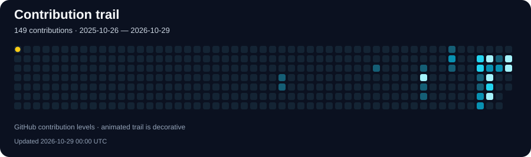
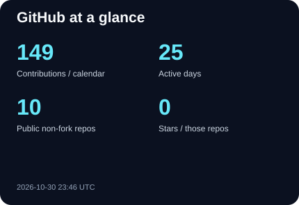
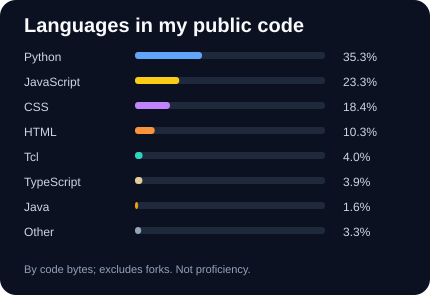
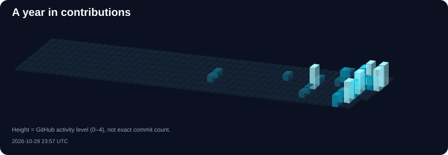

### Backend & DevOps Engineer · Da Nang, Vietnam

Java services. Cloud infrastructure. Automated delivery.

  
  
  
  

## 👋 Hey, I'm Dat

I'm interested in what happens on both sides of a deployment: **building the service and operating the infrastructure behind it**.

- ☕ **Backend:** Java, Spring Boot / Cloud, microservices, and event-driven architecture.
- ☁️ **DevOps:** AWS, Docker, Kubernetes, Terraform, and CI/CD automation.
- 🔭 **Learning next:** GitOps, DevSecOps, and reliability engineering.
- 💬 **Let's talk:** Spring, Kafka, Redis, container delivery, and observability.

  

## 🧰 Languages & Tools

#### Backend & messaging

  
  
  
  
  
  

Java · Spring Boot / Cloud · Hibernate / JPA · Kafka · RabbitMQ · Python

#### Cloud, containers & Infrastructure as Code

  
  
  
  
  
  
  

AWS / EKS · Docker · Kubernetes · Helm · Terraform · Ansible · Linux

#### CI/CD & automation

  
  
  
  
  
  

Git · GitHub Actions · GitLab CI/CD · Jenkins · Bash / Shell · YAML

#### Data & observability

  
  
  
  
  
  
  

PostgreSQL · MySQL · Redis · Elasticsearch · Prometheus · Grafana · OpenTelemetry

<b>More tools & engineering interests</b>

**API & identity:** Keycloak · Postman · Swagger / OpenAPI 
**Web:** TypeScript · Next.js 
**Logs & tracing:** Logstash · Kibana · Zipkin 
**Foundations:** SQL · domain-driven design · SAGA workflows · circuit breakers · caching

**Learning goals:** Argo CD · Kustomize · Trivy · Vault · SonarQube · Gitleaks · Loki · Tempo · OIDC · SLIs/SLOs · Kubernetes security.

## 📊 GitHub Stats & Languages

  
  

Languages describe the code in my public non-fork repositories, not proficiency. Contribution totals follow GitHub's calendar; contributions are not exclusively commits. Snapshots show their update time.

<b>🌃 My contribution skyline in 3D</b>

## ⚡ Recent Commits

<!-- ACTIVITY:START -->
- **2026-10-15** · [tiendat2712](https://github.com/tiendat2712/tiendat2712) · [1b7029d](https://github.com/tiendat2712/tiendat2712/commit/1b7029de44a1ed271d516ec10e6b89ff64e91ebf) — Refresh profile with animated contributions and Backend DevOps stack
- **2026-10-15** · [java-core-mastery](https://github.com/tiendat2712/java-core-mastery) · [69bebff](https://github.com/tiendat2712/java-core-mastery/commit/69bebffd8609e4931fa79d72058831d331ba9026) — Map knowledge
- **2026-10-15** · [java-core-mastery](https://github.com/tiendat2712/java-core-mastery) · [08bcfd4](https://github.com/tiendat2712/java-core-mastery/commit/08bcfd4f516594fb56b7f4a397672bb504944c08) — feat: generic - custom List
- **2026-10-15** · [tiendat2712](https://github.com/tiendat2712/tiendat2712) · [cb0c15b](https://github.com/tiendat2712/tiendat2712/commit/cb0c15b05eafa0694af97ce8b7b4a5813bbe106e) — feat(profile): redesign README in English with 3D isometric visuals and app icons
- **2026-10-14** · [tiendat2712](https://github.com/tiendat2712/tiendat2712) · [983b132](https://github.com/tiendat2712/tiendat2712/commit/983b132021772568a8c5f17ba4a2e591203d5e47) — style(profile): redesign layout with featured projects, about me and telemetry
- **2026-10-14** · [tiendat2712](https://github.com/tiendat2712/tiendat2712) · [e1b8bcd](https://github.com/tiendat2712/tiendat2712/commit/e1b8bcd615c5ef207700ac273288b290951ab97b) — feat(profile): redesign profile with 3D kubernetes animation, verified commits and languages

Updated 2026-10-15 09:26 UTC. Latest authored commits sampled from the default branches of owned public non-fork repositories.
<!-- ACTIVITY:END -->

## 🧊 From Code to Cloud

<b>Explore my target cloud delivery architecture</b>

A learning blueprint: source control → CI checks → container image → GitOps deployment → Kubernetes → telemetry. This illustration is not a claim about a production system I operate.

## 🎯 Certification Goals

**All certifications below are goals. I have not earned any of them yet.**

**Core goals:** Kubernetes administration, AWS architecture, and Terraform. 
**Further goals:** Kubernetes application delivery, security after CKA, and advanced AWS operations.

---

**Always learning. Building better systems, one commit at a time.**

[Let's connect](mailto:tiendat.xpbp@gmail.com) · [Explore my repositories](https://github.com/tiendat2712?tab=repositories)

Layout inspiration: <a href="https://github.com/hoangtien2k3/hoangtien2k3">hoangtien2k3</a> · Visuals and stack personalized for tiendat2712.

