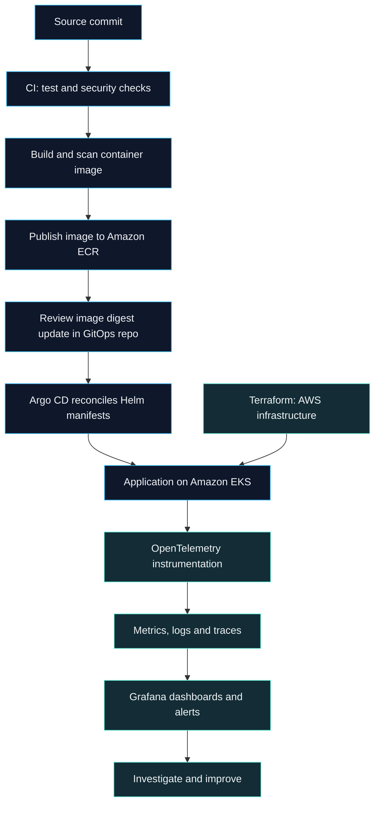

  

# Phan Trinh Tien Dat

**Backend & DevOps Engineer** · Da Nang, Vietnam

Building resilient services. Automating the path from code to cloud.

  
  
  

[About](#about) &nbsp; / &nbsp; [Stack](#technical-stack) &nbsp; / &nbsp; [DevOps roadmap](#devops-learning-roadmap) &nbsp; / &nbsp; [Certifications](#certification-goals)

---

## About

I'm Dat, a backend and DevOps engineer interested in the full journey of a service: **how it is designed, delivered, and operated**.

My focus is on **Java and Spring microservices**, **event-driven systems**, and **cloud infrastructure automation**. I enjoy connecting application architecture with the infrastructure that keeps it running.

- **Backend engineering** — Spring Boot, Spring Cloud, domain-driven design, Kafka, RabbitMQ, and Redis.
- **Cloud & delivery** — AWS, Docker, Kubernetes/EKS, Terraform, Ansible, and CI/CD pipelines.
- **Engineering growth** — distributed systems, GitOps, platform security, and service reliability.

## Technical Stack

  
  
  
  
  
  

### Cloud, infrastructure & delivery

| Area | Technologies |
| :--- | :--- |
| **Cloud & containers** | AWS · Amazon EKS · Docker · Kubernetes · Helm |
| **Infrastructure as Code** | Terraform · Ansible |
| **CI/CD & source control** | GitHub Actions · GitLab CI/CD · Jenkins · Git |
| **Systems & automation** | Linux · Bash / Shell · Python · YAML |
| **Observability** | Prometheus · Grafana · OpenTelemetry · Elasticsearch · Logstash · Kibana · Zipkin |

### Backend & data

| Area | Technologies |
| :--- | :--- |
| **Languages** | Java · SQL · Python · TypeScript |
| **Services & persistence** | Spring Boot · Spring Cloud · Hibernate / JPA |
| **Identity & APIs** | Keycloak · Swagger / OpenAPI · Postman |
| **Databases & caching** | PostgreSQL · MySQL · Redis · Elasticsearch |
| **Messaging & streaming** | Apache Kafka · RabbitMQ |
| **Web tooling** | Next.js |

## DevOps Learning Roadmap

The next tools and practices I want to develop through focused labs and projects.

  
  
  
  

| Track | Tools & concepts to explore | Practice goal |
| :--- | :--- | :--- |
| **GitOps & releases** | Argo CD · Kustomize · Helm · Amazon ECR | Version deployment configuration, detect drift, and practice rollback. |
| **AWS foundations** | IAM · VPC · EC2 · S3 · RDS · Route 53 · CloudWatch | Build a networked application environment with scoped access and useful telemetry. |
| **Kubernetes operations** | RBAC · NetworkPolicy · HPA · probes · resource limits · storage · Gateway API | Deploy, scale, and troubleshoot workloads; practice cluster backup and recovery. |
| **Networking & Linux** | TCP/IP · DNS · HTTP/TLS · NGINX · systemd | Trace connectivity problems from process to endpoint. |
| **DevSecOps** | Trivy · SonarQube · Gitleaks · SBOMs | Add image, code, and secret checks to a delivery pipeline. |
| **Secrets & identity** | HashiCorp Vault · External Secrets Operator · cert-manager · OIDC | Explore secret delivery, certificate automation, and short-lived CI credentials. |
| **Observability & SRE** | Grafana Loki · Tempo · Alertmanager · SLIs/SLOs · error budgets | Correlate logs, metrics, and traces; write actionable alerts and incident runbooks. |
| **Infrastructure quality** | Terraform modules · remote state · state locking · environment isolation | Make infrastructure changes reviewable, repeatable, and easier to recover. |

<strong>Learning blueprint · from commit to observable service</strong>

This is a target lab architecture for practicing the roadmap above.

**Backend architecture interests:** domain-driven design, event-driven communication, SAGA workflows, circuit breakers, bulkheads, caching, and distributed tracing.

## Certification Goals

**All certifications below are future goals; none have been earned yet.**

  
  
  

### Foundation & core goals

| Certification | Learning focus | Status |
| :--- | :--- | :--- |
| [**AWS Certified Solutions Architect – Associate**](https://aws.amazon.com/certification/certified-solutions-architect-associate/) | Resilient, secure, and cost-aware AWS architectures | Planned |
| [**Certified Kubernetes Administrator (CKA)**](https://www.cncf.io/training/certification/cka/) | Cluster administration, networking, storage, and troubleshooting | Planned |
| [**HashiCorp Certified: Terraform Associate**](https://docs.hashicorp.com/certifications/terraform-associate) | IaC fundamentals, configuration, state, and core workflows | Planned |

### Further specialization

| Certification | Learning focus | Status |
| :--- | :--- | :--- |
| [**Certified Kubernetes Application Developer (CKAD)**](https://www.cncf.io/training/certification/ckad/) | Application configuration and workloads on Kubernetes | Future goal |
| [**Certified Kubernetes Security Specialist (CKS)**](https://www.cncf.io/training/certification/cks/) | Cluster hardening, supply chain, and runtime security | After passing CKA |
| [**AWS Certified DevOps Engineer – Professional**](https://aws.amazon.com/certification/certified-devops-engineer-professional/) | Delivery automation, monitoring, resilience, and operations on AWS | Long-term goal |

Certification names link to official programs. CKS requires passing CKA before attempting the exam.

---

**Let's talk backend systems, cloud infrastructure, and developer workflows.**

[Email](mailto:tiendat.xpbp@gmail.com) &nbsp; · &nbsp; [Facebook](https://www.facebook.com/tien.at.563335) &nbsp; · &nbsp; [Instagram](https://www.instagram.com/johnleynguci/)

Phan Trinh Tien Dat · Da Nang, Vietnam

