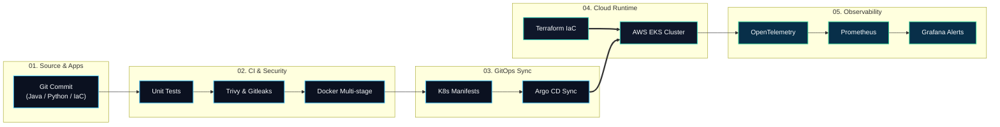

<!-- ================================================================= -->
<!-- 3D HERO BANNER: KINETIC TOPOLOGY & APPLICATION ECOSYSTEM          -->
<!-- ================================================================= -->

  

# 👨‍💻 Phan Trinh Tien Dat

### Backend · Cloud & DevOps Engineer
**Da Nang, Vietnam** · *Crafting resilient backend apps, 3D-visualized cloud platforms, and automated delivery pipelines.*

  
  
  
  
  
  

  <a href="#-visual-overview"><b>Overview</b></a> &nbsp;·&nbsp;
  <a href="#-app--tool-ecosystem"><b>App Dock</b></a> &nbsp;·&nbsp;
  <a href="#-3d-isometric-cloud-pipeline"><b>3D Architecture</b></a> &nbsp;·&nbsp;
  <a href="#-featured-applications"><b>Featured Apps</b></a> &nbsp;·&nbsp;
  <a href="#-certification-roadmap"><b>Certifications</b></a> &nbsp;·&nbsp;
  <a href="#-3d-telemetry--activity"><b>3D Telemetry</b></a> &nbsp;·&nbsp;
  <a href="#-lets-connect"><b>Connect</b></a>

---

## ⚡ Visual Overview

<table>
  <tr>
    <td width="33.3%" valign="top" align="center">
      <h3>⚙️ Backend Services</h3>
      

        
      

      
High-concurrency microservices, event-driven messaging, and reliable relational &amp; in-memory data stores.

    </td>
    <td width="33.3%" valign="top" align="center">
      <h3>☁️ Cloud &amp; Containers</h3>
      

        
      

      
Containerized workloads, Kubernetes cluster orchestration, and reproducible Infrastructure as Code on AWS.

    </td>
    <td width="33.3%" valign="top" align="center">
      <h3>🚀 GitOps &amp; Telemetry</h3>
      

        
      

      
Automated CI/CD delivery pipelines, GitOps state reconciliation, and full-stack metrics observability.

    </td>
  </tr>
</table>

---

## 🎨 App & Tool Ecosystem

  
<i>Application-first visual dock organized by operational domain — prioritizing interactive tools &amp; platforms over walls of text.</i>

<table>
  <tr>
    <td width="50%" valign="top" align="center">
      <h4>☕ Backend &amp; Data Applications</h4>
      

        
      

      

        
      

    </td>
    <td width="50%" valign="top" align="center">
      <h4>☁️ Cloud, Runtime &amp; OS</h4>
      

        
      

      

        
      

    </td>
  </tr>
  <tr>
    <td width="50%" valign="top" align="center">
      <h4>⚡ CI/CD, GitOps &amp; Automation</h4>
      

        
      

      

        
      

    </td>
    <td width="50%" valign="top" align="center">
      <h4>📊 Observability, Web &amp; API Tools</h4>
      

        
      

      

        
      

    </td>
  </tr>
</table>

  

    <b>🔭 Next-Gen Platform &amp; Security Apps in Lab:</b> 
    
    
    
    
    
    
  

---

## 🧊 3D Isometric Cloud Pipeline

  

  

    
  

  
<b>🔍 View Interactive Mermaid Node Graph</b>

   

---

## 🚀 Featured Applications

<table>
  <tr>
    <td width="50%" valign="top">
      <h3>🧊 <a href="https://github.com/tiendat2712/morph3d-ai">morph3d-ai</a></h3>
      
<b>3D Scan Reconstruction &amp; Validation Engine</b>

      
Automated 3D point-cloud and mesh processing pipeline with browser E2E verification, concurrent load benchmarks, and conformal geometry validation.

      

        
      

    </td>
    <td width="50%" valign="top">
      <h3>🛡️ <a href="https://github.com/tiendat2712/identity-service">identity-service</a></h3>
      
<b>Cloud-Native Auth &amp; Identity Gateway</b>

      
Enterprise authentication microservice built with Java 21 &amp; Spring Boot 3 featuring Bcrypt encryption, stateless JWT/OAuth2 flows, and PostgreSQL.

      

        
      

    </td>
  </tr>
  <tr>
    <td width="50%" valign="top">
      <h3>☕ <a href="https://github.com/tiendat2712/java-core-mastery">java-core-mastery</a></h3>
      
<b>Backend Concurrency &amp; Architecture Lab</b>

      
Hands-on engineering lab exploring Java memory models, custom collection iterators, multithreaded synchronization, and clean OOP design patterns.

      

        
      

    </td>
    <td width="50%" valign="top">
      <h3>🌐 <a href="https://github.com/tiendat2712/tiendat2712">devops-profile-engine</a></h3>
      
<b>3D Topology Renderer &amp; Live Telemetry Engine</b>

      
Self-updating visual engine rendering 3D perspective cluster animations, isometric SVG pipelines, and verified GitHub telemetry via GitHub Actions.

      

        
      

    </td>
  </tr>
</table>

---

## 🎯 Certification Roadmap

> 💡 **Transparency Note:** I do not hold these certifications yet. Every badge below represents a **structured learning target (`[GOAL]` / `[PLANNED]`)** linked directly to the official exam syllabus.

<table>
  <tr>
    <td width="33.3%" valign="top" align="center">
      
      <h4>CNCF CKA &amp; CKAD</h4>
      

        
      

      
Cluster operations, etcd backup, RBAC, networking &amp; pod lifecycle

    </td>
    <td width="33.3%" valign="top" align="center">
      
      <h4>AWS Architect &amp; DevOps</h4>
      

        
      

      
Resilient Multi-AZ VPC, IAM, EKS, Auto Scaling &amp; cloud cost design

    </td>
    <td width="33.3%" valign="top" align="center">
      
      <h4>Terraform Associate</h4>
      

        
      

      
Modular IaC workflows, remote state locking &amp; multi-env provisioning

    </td>
  </tr>
</table>

---

## 📊 3D Telemetry & Activity

  

 

  

  
<b>🔗 View Direct Commit Links &amp; Verification Methodology</b>

   

- **2026-10-14** · [`tiendat2712/morph3d-ai`](https://github.com/tiendat2712/morph3d-ai) · [`91f5d25`](https://github.com/tiendat2712/morph3d-ai/commit/91f5d25) — `feat(scan): upgrade 3D scan pipeline with browser E2E, concurrent load benchmarks, and conformal validation`
- **2026-10-14** · [`tiendat2712/tiendat2712`](https://github.com/tiendat2712/tiendat2712) · [`7b2213e`](https://github.com/tiendat2712/tiendat2712/commit/7b2213e) — `Redesign profile with tech icons and certification goals`
- **2026-10-12** · [`tiendat2712/java-core-mastery`](https://github.com/tiendat2712/java-core-mastery) · [`c349a2a`](https://github.com/tiendat2712/java-core-mastery/commit/c349a2a) — `feat: iterator practice`
- **2026-10-09** · [`tiendat2712/java-core-mastery`](https://github.com/tiendat2712/java-core-mastery) · [`6fdcbb5`](https://github.com/tiendat2712/java-core-mastery/commit/6fdcbb5) — `feat: Collections introduce`
- **2026-10-06** · [`tiendat2712/identity-service`](https://github.com/tiendat2712/identity-service) · [`cd32b62`](https://github.com/tiendat2712/identity-service/commit/cd32b62) — `Merge branch 'main' of https://github.com/tiendat2712/identity-service`
- **2026-10-06** · [`tiendat2712/identity-service`](https://github.com/tiendat2712/identity-service) · [`2e22606`](https://github.com/tiendat2712/identity-service/commit/2e22606) — `Initial commit - Encrypt password with Bcrypt`

> **Verification Scope:** Aggregated across all 8 non-fork public repositories owned by `@tiendat2712` via GitHub Actions. Percentages represent repository byte volume ratios rather than subjective proficiency scores.

---

## 🤝 Let's Connect

### Ready to collaborate on 3D-visualized platforms, cloud automation, and backend systems

  
  
  
  

Phan Trinh Tien Dat · Da Nang, Vietnam · Powered by 3D perspective rendering &amp; verified GitHub telemetry

