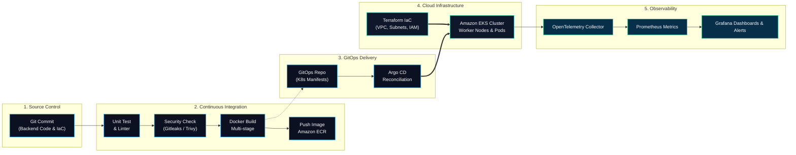

<!-- ================================================================= -->
<!-- HERO BANNER: 3D ANIMATED TOPOLOGY & CORE IDENTITY                 -->
<!-- ================================================================= -->

  

# Phan Trinh Tien Dat

### Backend · Cloud & DevOps Engineer
**Da Nang, Vietnam** · *Bridging resilient backend microservices and automated cloud platforms.*

  
  

[Engineering Focus](#engineering-focus) &nbsp;·&nbsp; [Tech Stack](#technical-stack) &nbsp;·&nbsp; [GitHub Activity](#verified-github-activity) &nbsp;·&nbsp; [Languages](#codebase-language-distribution) &nbsp;·&nbsp; [Certification Goals](#certification-goals) &nbsp;·&nbsp; [Architecture Lab](#hands-on-architecture-blueprint)

---

## Engineering Focus

My work focuses on the intersection where **software engineering meets platform infrastructure**: designing modular backend services in Java/Spring, provisioning reproducible infrastructure with Terraform, and orchestrating container workloads on AWS and Kubernetes.

- **Backend Engineering:** Java & Spring Boot microservices, REST APIs, asynchronous messaging with Apache Kafka and RabbitMQ, and caching with Redis.
- **Platform & Delivery:** Containerization with Docker, Kubernetes cluster orchestration, and automated CI/CD pipelines via GitHub Actions and GitLab CI.
- **Continuous Learning:** Progressing into GitOps with Argo CD, secrets governance with HashiCorp Vault, and distributed tracing with OpenTelemetry.

---

## Verified GitHub Activity

Hoạt động commit gần đây từ các kho lưu trữ công khai của **@tiendat2712**.

  

### Commit gần đây có liên kết kiểm chứng

- **2026-10-14** · [`tiendat2712/morph3d-ai`](https://github.com/tiendat2712/morph3d-ai) · [`91f5d25`](https://github.com/tiendat2712/morph3d-ai/commit/91f5d25) — `feat(scan): upgrade 3D scan pipeline with browser E2E, concurrent load benchmarks, and conformal validation`
- **2026-10-14** · [`tiendat2712/tiendat2712`](https://github.com/tiendat2712/tiendat2712) · [`7b2213e`](https://github.com/tiendat2712/tiendat2712/commit/7b2213e) — `Redesign profile with tech icons and certification goals`
- **2026-10-12** · [`tiendat2712/java-core-mastery`](https://github.com/tiendat2712/java-core-mastery) · [`c349a2a`](https://github.com/tiendat2712/java-core-mastery/commit/c349a2a) — `feat: iterator practice`
- **2026-10-09** · [`tiendat2712/java-core-mastery`](https://github.com/tiendat2712/java-core-mastery) · [`6fdcbb5`](https://github.com/tiendat2712/java-core-mastery/commit/6fdcbb5) — `feat: Collections introduce`
- **2026-10-06** · [`tiendat2712/identity-service`](https://github.com/tiendat2712/identity-service) · [`cd32b62`](https://github.com/tiendat2712/identity-service/commit/cd32b62) — `Merge branch 'main' of https://github.com/tiendat2712/identity-service`
- **2026-10-06** · [`tiendat2712/identity-service`](https://github.com/tiendat2712/identity-service) · [`2e22606`](https://github.com/tiendat2712/identity-service/commit/2e22606) — `Initial commit - Encrypt password with Bcrypt`

> **Phạm vi & Thời điểm cập nhật**: Dữ liệu commit được trích xuất trực tiếp từ các commit thực tế trong các kho lưu trữ công khai của tài khoản `tiendat2712`. Script tự động cập nhật qua GitHub Actions định kỳ và lưu bản hợp lệ gần nhất khi API bị giới hạn lưu lượng.

---

## Codebase Language Distribution

Biểu đồ thống kê dung lượng mã nguồn qua các kho lưu trữ thực tế của tôi.

  

> **Phương pháp thống kê & Xử lý fork**:
> - **Phạm vi**: Tổng hợp trên toàn bộ 8 repository công khai do `@tiendat2712` sở hữu.
> - **Xử lý fork**: Loại bỏ 100% repository fork nhằm phản ánh trung thực mã nguồn do tác giả tự khởi tạo và phát triển.
> - **Ý nghĩa số liệu**: Tỷ lệ phần trăm thể hiện **cơ cấu dung lượng byte mã nguồn (codebase volume ratio)** giữa các dự án (Python, JavaScript, CSS, HTML, TypeScript, Java...), **không đại diện cho mức độ thành thạo cá nhân**.

---

## Technical Stack

Công nghệ được phân loại rõ ràng theo từng mảng chuyên môn, phân biệt giữa công nghệ đang thực hành trong hồ sơ/dự án và công nghệ thuộc lộ trình học tập.

### 1. Backend & Distributed Systems
*Nền tảng dịch vụ, giao tiếp bất đồng bộ và cơ sở dữ liệu backend.*

  
  
  
  
  
  
  
  

- **Trong hồ sơ / Thực hành:** Java 21, Spring Boot, Spring Cloud, Spring Data JPA / Hibernate, Apache Kafka, RabbitMQ, PostgreSQL, MySQL, Redis, RESTful API design.
- **Hệ sinh thái web & API bổ trợ:** TypeScript, Next.js, Postman, OpenAPI / Swagger, Keycloak.

### 2. Cloud & Containers
*Hạ tầng đám mây và môi trường vận hành ứng dụng đóng gói.*

  
  
  
  

- **Trong hồ sơ / Thực hành:** Docker (multi-stage builds, image optimization), Kubernetes (Pods, Deployments, Services, ConfigMaps, Secrets), Amazon Web Services (EC2, VPC, S3, RDS, EKS fundamentals), Linux system administration (Ubuntu/Debian, systemd, networking).
- **Công cụ đóng gói bổ trợ:** Helm charts cơ bản cho Kubernetes.

### 3. CI/CD & GitOps
*Tự động hóa quy trình kiểm thử, đóng gói và triển khai mã nguồn.*

  
  
  
  
  
  

- **Trong hồ sơ / Thực hành:** Git flow, GitHub Actions (automated pipelines, releases, asset generation), GitLab CI/CD, Jenkins pipelines, Bash scripting, Python automation.
- **Lộ trình học tập (Roadmap Goal):** Argo CD (GitOps deployment reconciliation, automated sync & rollback), Kustomize (environment overlay management).

### 4. Infrastructure as Code (IaC)
*Định nghĩa và quản lý tài nguyên hạ tầng bằng mã nguồn có thể tái tạo.*

  
  

- **Trong hồ sơ / Thực hành:** Terraform (HCL syntax, module structures, state management, variables/outputs), Ansible (playbooks cho cấu hình máy chủ Linux).
- **Lộ trình học tập (Roadmap Goal):** Terraform remote state locking với S3 + DynamoDB, multi-environment isolation (Dev/Staging/Prod).

### 5. Observability & SRE
*Giám sát hiệu năng hệ thống, thu thập log và cảnh báo độ tin cậy.*

  
  
  

- **Trong hồ sơ / Thực hành:** Prometheus (metrics scraping, alerting rules), Grafana (dashboards, telemetry visualization), Elasticsearch (log storage), Zipkin & OpenTelemetry fundamentals.
- **Lộ trình học tập (Roadmap Goal):** Grafana Loki (log aggregation), Grafana Tempo (distributed tracing), định nghĩa SLI/SLO và thiết lập incident response runbooks.

### 6. DevSecOps & Platform Security
*Tích hợp bảo mật vào quy trình phát triển và vận hành hệ thống.*

  
  
  
  

- **Lộ trình học tập (Roadmap Goal):** Quét lỗ hổng container image với Trivy, phát hiện rò rỉ bí mật với Gitleaks, quản lý thông tin bảo mật tập trung với HashiCorp Vault, kiểm soát danh tính và truy cập qua OIDC / Keycloak, quản lý chứng chỉ tự động với cert-manager.

---

## Certification Goals

> ⚠️ **Cam kết minh bạch về chứng chỉ**:
> **Tôi hiện chưa sở hữu bất kỳ chứng chỉ nào.** Tất cả các chứng chỉ dưới đây là **mục tiêu học tập có lộ trình rõ ràng (Goals / Planned Milestones)**. Các liên kết dẫn trực tiếp tới cổng thông tin khảo thí chính thức của CNCF, AWS và HashiCorp để người xem tiện tra cứu chuẩn kiến thức.

### Mục tiêu trọng tâm (Core Milestone Goals)

  
  
  

- **Certified Kubernetes Administrator (CKA):** *Mục tiêu [GOAL]* — Vận hành cụm Kubernetes thực tế: cluster architecture, etcd backup/restore, networking, persistent storage, scheduling và khắc phục sự cố node/pod.
- **AWS Solutions Architect – Associate (AWS SAA):** *Mục tiêu [GOAL]* — Thiết kế kiến trúc đám mây AWS bền bỉ, an toàn, hiệu năng cao và tối ưu chi phí (VPC, Multi-AZ, IAM, Auto Scaling, S3, RDS).
- **HashiCorp Certified: Terraform Associate 003:** *Mục tiêu [GOAL]* — Chuẩn hóa quy trình Infrastructure as Code: state lifecycle, module reuse, execution plans, và biến môi trường.

### Mục tiêu nâng cao & dài hạn (Advanced Planned Milestones)

  
  
  

- **Certified Kubernetes Application Developer (CKAD):** *Kế hoạch [PLANNED]* — Đóng gói, kiểm soát vòng đời ứng dụng trên k8s, Canary/Blue-Green deployments, probe và volume configurations.
- **Certified Kubernetes Security Specialist (CKS):** *Kế hoạch [PLANNED SAU CKA]* — Tăng cường bảo mật cụm: cluster hardening, container runtime security, network policies và giảm thiểu bề mặt tấn công.
- **AWS Certified DevOps Engineer – Professional:** *Mục tiêu dài hạn [LONG-TERM GOAL]* — Tự động hóa phân phối ứng dụng quy mô lớn, giám sát hệ thống phân tán, chiến lược phục hồi sự cố tự động (DR) trên AWS.

---

## Hands-on Architecture Blueprint

Mô hình kiến trúc tham chiếu cho các lab thực hành từ commit mã nguồn tới hệ thống giám sát tự động:

---

### Let's collaborate & build reliable platforms

[Email: tiendat.xpbp@gmail.com](mailto:tiendat.xpbp@gmail.com) &nbsp;·&nbsp; [GitHub: tiendat2712](https://github.com/tiendat2712) &nbsp;·&nbsp; [Facebook](https://www.facebook.com/tien.at.563335) &nbsp;·&nbsp; [Instagram](https://www.instagram.com/johnleynguci/)

Phan Trinh Tien Dat · Da Nang, Vietnam · Crafted with genuine 3D perspective animation and verified GitHub telemetry

